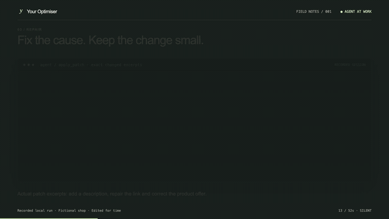

# Your Optimiser


**Your autonomous SEO agent.**

[Website](https://youroptimiser.com) · [How it works](https://youroptimiser.com/how-it-works) · [GitHub](https://github.com/YourOptimiser/your-optimiser)

**Free for personal, non-commercial local use only.** Commercial or business use,
hosting a service, redistribution and reuse in other products require separate written
permission from Your Optimiser. [Read the licence](LICENSE) or
[contact the team about licensing](https://youroptimiser.com/contact).

Your Optimiser is an autonomous SEO agent that checks website changes, identifies supported SEO issues, prepares focused
fixes and verifies the served result. Healthy updates do not need an edit. GitHub is the
hosted repository integration; your team reviews proposed pull requests.

## Watch the agent work

[](https://youroptimiser.com/how-it-works#agent-demo)

[Watch the full 52-second demo](https://youroptimiser.com/how-it-works#agent-demo) · [Download the silent MP4](https://github.com/YourOptimiser/your-optimiser/releases/download/v1.0.0-beta.1/agent-at-work.mp4)

A real local run on a fictional shop: four confirmed defects, two repaired source files,
project checks and a browser before/after. A repeat audit created no new commit. Edited for
time; this demonstration does not claim a live GitHub PR or a search-ranking improvement.
[Inspect the recorded evidence](reports/agent-session.json).

## How it works

1. Connect a repository and the website it serves. Choose the branch and pages to monitor.
2. The agent inspects relevant changes and collects current page evidence.
3. Confirmed issues become findings with evidence and proposed changes. Missing facts remain
   dependencies rather than invented content.
4. Source edits must pass project permissions and configured verification.
5. After an approved change is deployed, the agent checks the live page and records the outcome.

Coverage includes technical SEO, content, AI-search discovery, local business facts, ecommerce
and international targeting. Checks distinguish directly observed defects from questions that
need external data. Search rankings, citations and traffic are not guaranteed.

[Try the interactive example](https://youroptimiser.com/#how) · [Read the blog](https://youroptimiser.com/blog)

## Run locally

From a checkout, with Git installed:

```sh
./run.sh
```

Windows PowerShell:

```powershell
.\run.ps1
```

The launcher installs the Python runtime and dependencies, then guides you through connecting
a local project, choosing an inference endpoint and scheduling checks. Automatic edits start
disabled. Your credentials stay in your installation; they do not belong in Git.

The source-available local version uses the [Your Optimiser Personal Local Use License](LICENSE).
It permits an individual's personal, non-commercial local installation and private configuration
changes. It does not permit business use, resale, redistribution, reuse in other projects or
operating a hosted service without written permission. The official hosted application has its
own account, usage limits and [service terms](https://youroptimiser.com/terms).

Earlier versions distributed under MIT retain their previously granted permissions;
the [historical MIT notice](LICENSES/Legacy-MIT.txt) is preserved. Third-party dependencies
remain under their own licences.

[Local setup](docs/local-setup.md) · [Single-service Cloud Run deployment](docs/single-service-deploy.md) · [Hosted configuration](docs/hosted-setup.md)

## Development

Python 3.12, uv and a Next.js frontend. Knowledge, contracts and evaluation work independently
of the dashboard.

```sh
uv sync --locked --all-extras
uv run pytest -q
uv run ruff check src tests scripts api
uv run ruff format --check src tests scripts api
uv run mypy
npm ci --prefix frontend
npm run typecheck --prefix frontend
npm test --prefix frontend
```

Offline tests need no model key or GitHub credentials. Optional Firestore integration tests
require the emulator. With Docker running, `uv run python scripts/verify_workflows.py --sandbox`
also exercises real isolated checks, temporary Git publication and served-page verification.
The [workflow report](reports/workflow-validation.json) separates scripted decision tests from
actual model quality and live search outcomes. The [real repair run](reports/repair-workflow-verification.json)
records four verified repairs, healthy controls, and earlier failed attempts.
See [architecture](docs/architecture.md), [benchmark protocol](docs/benchmark.md)
and [supported content workflows](docs/research-workspace.md) for engineering details.

## Security and privacy

Project permissions, tenant checks, validated evidence and isolated build execution constrain
agent actions. Untrusted page or repository text cannot grant permissions. Secrets belong in
ignored local configuration or the deployment's secret store. Never commit environment files,
private keys, credentials or personal-site test data.

To request a private reporting channel, use [the contact page](https://youroptimiser.com/contact)
without posting sensitive details publicly. The hosted [privacy notice](https://youroptimiser.com/privacy)
and [terms](https://youroptimiser.com/terms) describe service data handling and limits.

## Connect publishing platforms and search evidence

The workspace now includes project-scoped connectors for WordPress, WooCommerce,
Shopify, Webflow, GitLab, Bitbucket, Wix, Squarespace, Framer, Sanity and Contentful.
Search Console, GA4, Bing, Business Profile, Cloudflare, server logs, deployment
notifications, keyword/SERP data and AI-answer experiments add evidence around repairs.

Each connector declares what it can read or change. CMS updates use reviewable field
proposals, provider readback and a separate live-page check; platform limits remain
explicit. New-host Git adapters currently support guarded metadata PRs. Credentials
are encrypted and writes follow project policy. Paid experiments run only on request.

Local fixture and controlled-provider tests exercise these workflows. Live accounts
and search outcomes still require a production pilot. See the [connector guide](docs/connectors.md)
for the support matrix, account setup, OAuth callback, webhook contract and test commands.
