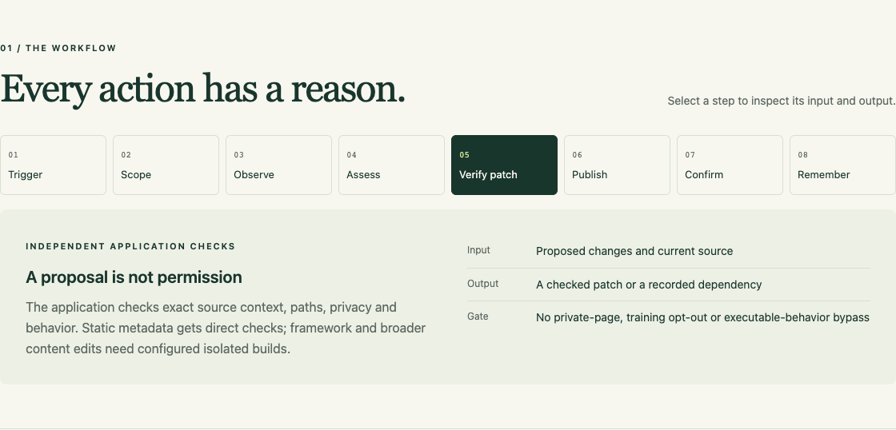
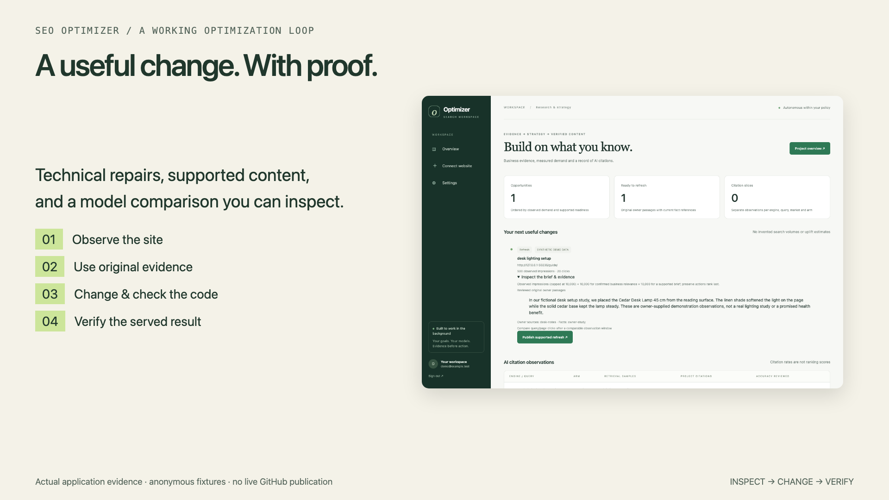
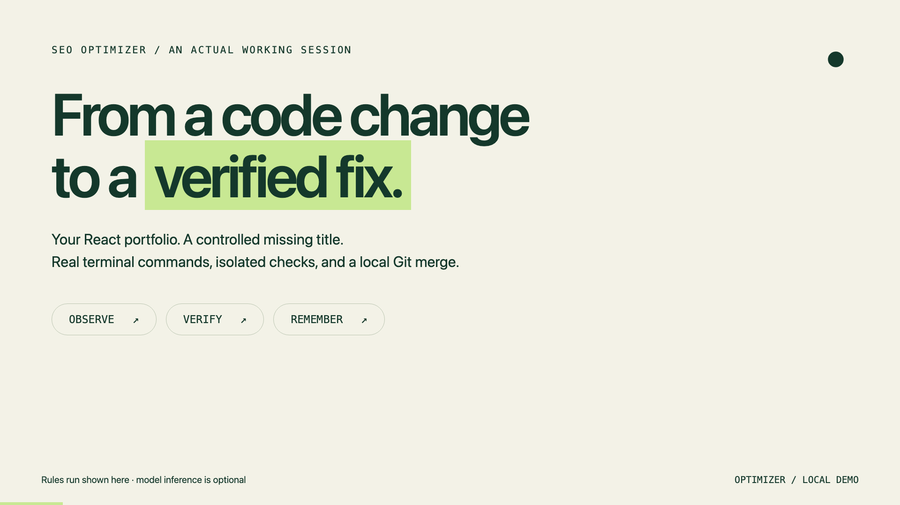
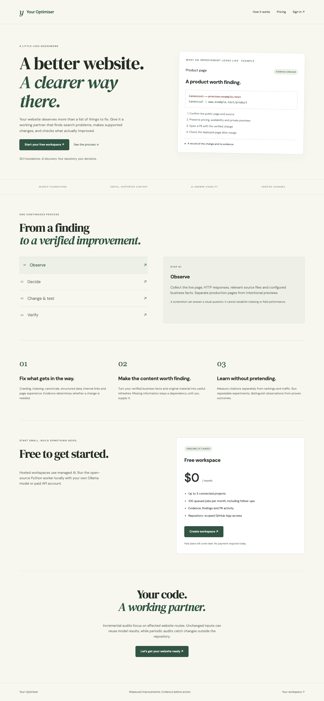
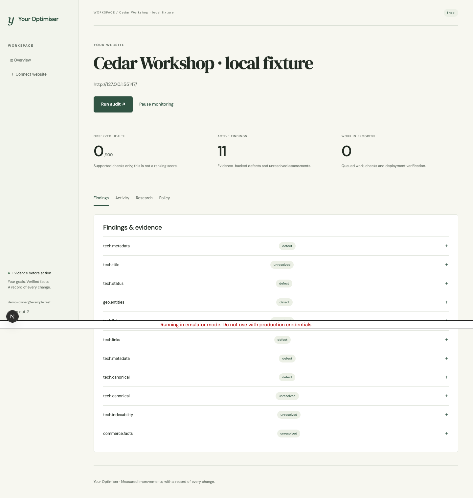
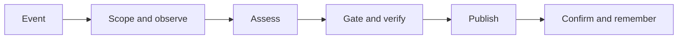
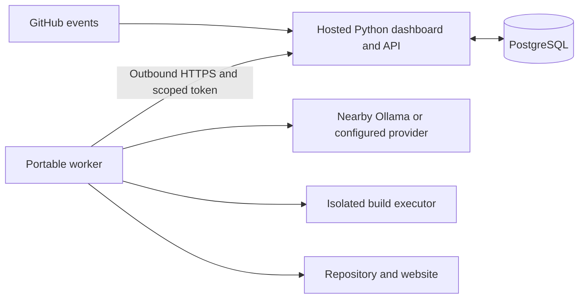

# Your Optimiser

**An autonomous Python optimization service: evidence, strategy, source changes, and verified publication.**

Connect a website and its Git repository. Your Optimiser gathers page and source evidence,
uses rules or a model to assess it, and makes the changes your project policy permits.
The dashboard shows what it found, what it changed, what passed verification, and what still
needs evidence. Run the Python dashboard and worker locally, or use the Next.js frontend with a hosted Python API and worker.

[Start locally](#start-locally) · [How it works](#how-it-works) · [Test your own site](#test-your-own-site) · [Local setup](docs/local-setup.md) · [Hosted setup](docs/hosted-setup.md)

**Explore the interactive guide:** start the dashboard and open
[localhost:8787/guide](http://127.0.0.1:8787/guide).
Click through a job, compare evidence/policy decisions, and switch installation setups.
If your server uses another port, open `/guide` on that server.

[](http://127.0.0.1:8787/guide)

**Watch the latest setup and repair demo:** [Your Optimiser — actual browser and model work](docs/assets/your-optimiser.mp4).
[Current recording evidence](docs/your-optimiser-video.md).

**Watch the expanded workflow demo:** the new recording adds research briefs, autonomous
content publication, actual Docker/Git/HTTP checks, and matched local-versus-paid repair results.

[](docs/assets/optimizer-workflow.mp4)

[Workflow evidence and limitations](docs/workflow-video.md) · [Research setup and APIs](docs/research-workspace.md) ·
[Actual model comparison](reports/model-repair-comparison.md)

**Earlier technical repair recording:** the worker inspects a fictional storefront, repairs a broken shopping
link and metadata/product-data defects, runs isolated checks, and verifies the served result.
The recorded case moves from four confirmed defects to zero across two model-edited files.

[](docs/assets/optimizer-demo.mp4)

[Actual model actions, limitations and reproduction](docs/demo-video.md) ·
[Anonymous run evidence](videos/public/agent-run.json)


The README includes expandable examples and diagrams. Its JavaScript interactions live in the
companion app page. GitHub supports [Mermaid diagrams](https://docs.github.com/en/get-started/writing-on-github/working-with-advanced-formatting/creating-diagrams)
and [expandable sections](https://docs.github.com/en/get-started/writing-on-github/working-with-advanced-formatting/organizing-information-with-collapsed-sections).

## Your workspace

[](docs/hosted-setup.md)

[](reports/hosted-ui.json)

The dashboard capture uses a fictional local site, real Firebase emulator sign-in, Firestore,
and an actual rules audit. It is not a deployed customer account or a claimed model repair.
[Clean installation evidence](reports/clean-install.json) · [Fresh model repair evidence](reports/onboarding-repair.json) · [Complete delivery report](reports/your-optimiser-delivery.md)

## What it does

| You connect | The worker does | You can inspect |
|---|---|---|
| A repository and served website | Maps source files to routes; audits affected pages after changes | Revision, URLs, coverage and collected findings |
| Owner policy and business facts | Preserves private pages, crawler opt-outs and existing behavior | Evidence, source references, dependencies and proposed edits |
| Rules, Ollama or a cloud model | Uses bounded inspection tools and locally validated output | Provider, available tokens/cost and actual tool results |
| Reviewed owner material and dated query/page data | Builds a supported brief and queues original content refreshes | Sources, facts, dependencies, priority explanation and served publication |
| Search-account access or engine transcripts | Imports search observations and records grounded API citations | Measurement windows, engine/arm slices, unresolved URLs and attribution limits |
| Build commands and publishing permissions | Verifies a patch, commits each file, checks and merges permitted work | Checks, PR/revisions, deployment confirmation and verified fixes |

The private knowledge covers technical SEO, page experience, content strategy, AI search,
local businesses, ecommerce, international sites and measurement. It contains eight focused
references, 39 checks and 31 attributed sources reviewed October 12, 2026.

[Implemented scope and qualification](docs/product-scope.md) · [Model comparison protocol](docs/benchmark.md)

**Coverage is explicit.** The catalog is broader than the deterministic scanners. A check can
be assessed, need model interpretation, need external evidence, or not apply. Unavailable
rankings, field performance, citations and conversions remain unknown. Observed audit health
summarizes completed checks; it is not a search ranking or a guaranteed visibility score.

## From evidence to a useful next change

Open a project's **Research workspace**. Import original owner material and dated query/page
observations. Expand a brief to see its supported passage, source references and dependencies.
Synthetic data is visibly labeled; missing demand, claims and citations stay unknown.

When the project enables `auto_content_refresh`, `allow_content_publication`, and `auto_fix`
with configured build checks, a completed audit queues strategy and one supported refresh.
The worker uses current owner-backed text, verifies the staged source, commits within policy,
and inspects the served page. It does not duplicate content on repeat runs.

Technical model repairs preserve body claims. Changing a broken link requires observed failure
and an observed public replacement. New body copy goes through the supported content task.
The [research guide](docs/research-workspace.md) documents setup, contracts and account access.

**Compute follows changed inputs.** Irrelevant mapped changes skip inference. Identical model
inputs can reuse a prior assessment after collecting fresh evidence; source, policy, provider,
knowledge, workspace and expired facts invalidate that reuse. Verified staged tool proposals
can finish without a redundant model response; independent publication checks still run.

<details>
<summary>Run a real local-versus-paid repository benchmark</summary>

```sh
uv sync --locked --extra browser
uv run playwright install chromium
uv run seo-optimizer benchmark-repairs --local-model gemma4:12b \
  --paid-model gemini-3.8-flash --output .data/repair-benchmark/run.json
```

The five arms share a frozen anonymous repository and owner facts. They compare rules alone,
minimal/full harnesses for a local model, and minimal/full harnesses for a paid model. Native
calls make real source changes, execute isolated checks, and verify served outcomes. A healthy
site and a documentation-only branch merge provide controls. Failed attempts remain in the
report; costs without configured rates and hardware measurements stay unknown.

The recorded frozen run verified 4/4 repairs with the paid full harness, 0/4 with its minimal
runner, and local request timeouts in both local arms. See [actual observations](reports/model-repair-comparison.md).

This is a development-case experiment. It does not establish broad model superiority, search
uplift or production GitHub success. See [the protocol](docs/benchmark.md).

</details>

## Start locally

From a fresh checkout, run:

```sh
./run.sh
```

Windows PowerShell:

```powershell
.\run.ps1
```

The launcher installs **uv and Python 3.12** if needed, installs locked application dependencies,
and walks you through the data folder, your website repository/URL, model, account and schedule.
**Git is the only prerequisite.** A network connection is needed on the first install.
The dashboard opens automatically; **Ctrl+C stops both the dashboard and worker**.
Subsequent launches reuse your setup. No Node, Firebase or cloud account is needed for local use.

Choose **rules** for no model account, **Ollama** for an installed local model, or
**Google/OpenAI/Anthropic** with your own key. Keys are entered privately and encrypted in the
local database. Automatic edits start off; setup can enable verified metadata repairs.
Local publication is a separate `auto_merge` policy setting. Docker is required for configured
project build/test commands, rather than basic metadata audits.

The foreground worker reconciles hourly by default. Choose cron during setup, or install an
idempotent five-minute wake-up with `./run.sh --no-start --schedule cron`. Other cron entries
are preserved. The application still controls the per-project reconciliation interval.

Private data defaults to `~/.local/share/your-optimiser/<installation-id>/`.
The ignored `.your-optimiser.json` remembers the project/data location and port; it contains no
provider keys or passwords. Back up the database **with** its `secret.key`.

[First-run guide, schedules and troubleshooting](docs/local-setup.md)

**Hosted application:** `frontend/` contains the Next.js landing page, free pricing, Firebase
sign-in, guided GitHub onboarding, evidence dashboard, research and PR activity. The Python
API/worker use Firestore, GitHub App access, server-side model configuration and isolated build
verification. [Cloud Run + Next deployment](docs/hosted-setup.md).

<details>
<summary><strong>Try the small built-in demo first</strong></summary>

```sh
uv run seo-optimizer demo
```

This creates a real local Git repository, a queued project and a one-time demo login. Start the
fixture website using the command it prints, then start the dashboard and worker.
The worker adds a missing title using observed page text, verifies it, commits and merges it,
and fetches the served page again. A repeated audit creates no additional fix commit.

</details>

<details>
<summary><strong>Connect an existing local repository</strong></summary>

Local paths must fall inside administrator-configured roots. The default permitted root is
`.data/`. To work with other folders, set an absolute root before starting the processes:

```sh
# In an ignored .env file, for example
OPT_REPO_ROOTS=/absolute/path/to/your/projects
```

Configure `local_path`, the checked-out `branch`, `allowed_paths` and `route_map` in the project.
The worker snapshots committed code. It refuses a local merge if the target branch changes,
is not checked out, or has uncommitted work.

For a static site, a route map might contain `"/": "public/index.html"`. Shared layouts,
response configuration and uncertain dependencies can trigger a broader audit.

</details>

<details>
<summary><strong>Use Ollama or another provider</strong></summary>

Start Ollama separately and inspect your installed models:

```sh
ollama list
```

Select **Ollama** and an actual model ID in the project. The default worker-side endpoint is
`http://127.0.0.1:11434`. Tool calling, JSON Schema and vision are separate capabilities; enable
only capabilities supported by the selected model. Context size, thinking, steps and timeouts
are explicit project settings.

OpenAI, Anthropic and Google use native adapters. Enter their model ID and credential through
authenticated settings. Configure current token prices if you need monetary accounting.
Missing usage or pricing remains unknown; the app cannot retroactively cap provider billing.

A working tool call or schema response is not a quality benchmark. Test the model's decisions
before allowing autonomous publication. Earlier local-model trials retained failed decisions;
rules remain the default.

</details>

## How it works



1. **Trigger and scope.** Signed GitHub events, manual audits and periodic reconciliation queue
   work. Duplicate events reuse jobs; stale pushes are superseded. Known unrelated changes skip
   model work. Backend response and shared layout changes can affect website pages too.
2. **Observe.** Bounded same-origin collection records responses, metadata, directives and links.
   Optional Chromium supplies rendered DOM and screenshots. Evidence has project scope and dates.
3. **Assess.** Rules identify directly observable issues. A configured model loads relevant private
   references and can inspect confined files, collected routes, diffs and configured checks.
   Page and repository text are evidence, not instructions that grant authority.
4. **Gate and verify.** The application validates output locally, checks source/evidence references,
   applies exact permitted replacements and runs applicable verification. Stale context, wrong
   paths, failed tools, privacy changes and unsupported claims prevent publication.
5. **Publish and confirm.** Local merges require a clean, unchanged target. GitHub uses PRs,
   required-check gates and rebase merging. The worker waits for the merged deployment SHA,
   then re-fetches affected pages. A confirmed failed fix can permit a guarded rollback while
   no newer branch change exists. An unavailable site is inconclusive.
6. **Remember.** Stable finding identities suppress repeated wording; re-audits resolve findings
   only on observed pages. Jobs retain outcomes, revisions, checks and available model usage.

### A concrete example

A public page has no `<title>`, but its actual main heading is “Field Notes.” A supported
metadata change is:

```diff
 <head>
+<title>Field Notes</title>
```

That becomes a verified fix only after the source patch passes policy and checks and the
served response contains the expected title. For a JavaScript-rendered page, the worker can
use a settled same-page DOM heading, keeping its HTTP and DOM evidence references.
A screenshot alone cannot justify the title or establish indexing status.

<details>
<summary><strong>When does it deliberately leave a page alone?</strong></summary>

- The page is already adequate for the assessed requirement.
- A preview/private page is intentionally excluded from search.
- Training is blocked while search discovery remains allowed by owner policy.
- A new content claim lacks current authoritative facts.
- A required inspection/build fails, the source has changed, or evidence is inconclusive.

“No change” is a useful outcome. A model's declared action or success cannot override these gates.

</details>

## What automatic changes are allowed?

| Change | Prerequisites |
|---|---|
| Static HTML metadata | Real finding, exact source, allowed path, preserved privacy/behavior and direct checks |
| Framework metadata | The same boundaries plus configured isolated build verification |
| Simple crawler-policy repair | Explicit matching owner bot intent; preserve independent training/discovery preferences |
| Broader static HTML/Markdown content | Explicit publication policy, current owner fact references, source material and configured checks |
| GitHub merge | Allowed by project policy, exact PR/base revisions, passing required checks and repository permissions |

Build commands run in a **Docker sandbox** with no network, a read-only source mount, non-root
UID and resource limits. Prebuild dependencies into the verification image. Worktree isolation
alone does not sandbox execution. Missing prerequisites block the job with a recorded dependency.

Content permission does not grant arbitrary application-code changes. Fact references and
schema validation establish provenance and structure; they do not prove every sentence true.
Business profiles, merchant feeds, search analytics and citation reports require their own
authorized account evidence. Repository access does not grant those permissions.

## Test your own site

### Offline suite

```sh
uv run seo-optimizer validate
uv run pytest -q
uv run ruff check src tests scripts api
uv run ruff format --check src tests scripts api
uv run mypy
uv build
```

Ordinary tests block network access. Explicit loopback integration tests exercise temporary
Git commits/merges and HTTP verification. No GitHub credential or paid model is required.
The suite also checks tenants, CSRF, encrypted secrets, replayed webhooks, native provider
protocols, leases, repeated findings and recovery/rollback gates.

### Real portfolio experiment

The opt-in test accepts a privately supplied legacy React portfolio repository URL,
builds its application in Docker, and tests a separate local branch. It never pushes
upstream. The historical biography is test data, not evidence of a current role or affiliation.

```sh
uv sync --locked --extra browser
uv run playwright install chromium

# Build dependencies and compiled preview assets; requires running Docker
uv run python scripts/test_portfolio.py --repository-url "$PRIVATE_TEST_REPOSITORY" --skip-model
```

The runner creates `.data/portfolio-test` and `.data/portfolio-built` and starts its own temporary
loopback fixture server. To explore the resulting site after the test, run:

```sh
uv run python scripts/portfolio_fixture.py \
  --repository .data/portfolio-test --build .data/portfolio-built --port 8811
```

The fixture serves the real compiled React assets and reflects `public/index.html` head edits.
This is an explicit metadata deployment simulation, not a live cloud deployment. The runner
checks the existing site, introduces a missing title, repairs it from rendered evidence, runs a
real isolated build, merges the local fix, and verifies that repeating the audit creates no commit.

With Ollama running, run the model-assisted metadata audit too:

```sh
uv run python scripts/test_portfolio.py --reuse-build --model gemma4:12b
```

The runner selects a fresh test branch from the downloaded upstream revision on each invocation. Reports preserve actual model
failures and publication decisions. It refuses to proceed over uncommitted test-checkout work.
Reports default to ignored `.data/portfolio-runs/latest.json`. Keep repository URLs,
identity and personal-site evidence in local configuration and ignored reports.

### Evaluate model decisions

```sh
uv run seo-optimizer benchmark-live \
  --cases tests/fixtures/cases.json --provider ollama --model YOUR_MODEL \
  --arm hybrid --limit 17 --output reports/my-model.json
```

Hybrid evaluation uses rules first and calls the model only for unsupported checks. The protocol
records how many cases actually used inference; a combined score is not a model-only score.
Use `--arm model-only` to isolate model behavior. Keep held-out cases separate from tuning.

<details>
<summary><strong>Replay saved fixtures and export schemas</strong></summary>

```sh
uv run seo-optimizer schemas --output schemas
uv run seo-optimizer evaluate --cases tests/fixtures/cases.json \
  --responses tests/fixtures/reference-responses.json --split all \
  --output reports/reference-replay.json
uv run seo-optimizer rules --cases tests/fixtures/cases.json \
  --output reports/rules-responses.json
uv run seo-optimizer evaluate --cases tests/fixtures/cases.json \
  --responses reports/rules-responses.json --split all \
  --output reports/rules-baseline.json
```

The 41 authored reference responses test the rubric, not inference quality. The limited rules
replay leaves unsupported cases skipped. Deliberately adversarial responses must fail.
Evaluation exits: `0` all passed, `1` failed/invalid, `2` incomplete with no failures.
Unknown cost components remain null; zero Ollama API cost does not mean zero operating cost.

</details>

## Local worker, hosted dashboard



Vercel serves `api.index:app`; production persistence uses PostgreSQL and a stable secret.
Repository processing, builds and inference stay in the portable worker. A local worker connects
outbound with `OPT_CONTROL_URL` and a scoped token, so Ollama needs no public tunnel.
Production cookies require HTTPS. See [deployment setup](docs/deployment.md) and [.env.example](.env.example).

## Find your way around

| Location | Responsibility |
|---|---|
| `src/seo_optimizer/contracts.py`, `application_models.py` | Typed inputs, observations, findings, project/provider policy and decisions |
| `knowledge/`, `knowledge.py`, `policy.py` | Private references, check/source integrity and evidence/policy validation |
| `crawler.py`, `scanner.py`, `performance.py` | HTTP/rendered collection, assessed coverage and optional official diagnostics |
| `llm.py` | Native provider requests, bounded tools, schema validation and measured usage |
| `execution.py`, `github.py`, `worker.py` | Confined edits, isolated checks, commits, publication and verification |
| `store.py`, `remote.py`, `web.py`, `ui/` | Tenant persistence, connected workers, APIs, dashboard and interactive guide |
| `videos/` | Remotion composition, real terminal/browser recordings and render scripts |
| `scripts/`, `tests/`, `reports/` | Reproducible experiments, offline regression checks and actual outcomes |

Read the [architecture](docs/architecture.md), [benchmark protocol](docs/benchmark.md) and
[delivery evidence](reports/delivery.md) for implementation details and unverified external outcomes.
