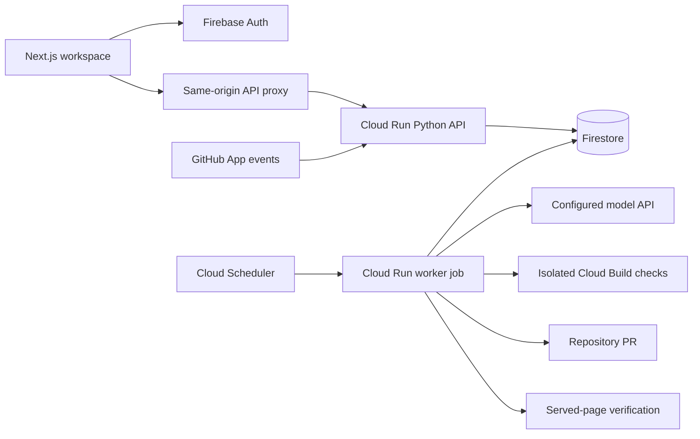

# Host Your Optimiser

For the initial beta, use [the single-service deployment](single-service-deploy.md) and root
`./deploy.sh`: frontend, API and task execution share one Cloud Run service. The separate-service
layout below remains available for deployments that need independent scaling.

The hosted product has a **Next.js frontend**, a **Python API on Cloud Run**, **Firebase Auth**,
**Firestore storage**, and a **Cloud Run job** for the portable SEO worker. Model configuration
is server-owned; customer flows say “managed AI”. `OPT_MANAGED_PROVIDER`,
`OPT_MANAGED_MODEL` and the managed key select a supported paid adapter without UI changes. Local installations retain their own provider
choices. The existing Python/Jinja dashboard remains the lightweight local option.



## Provisioning

1. Select the intended Google Cloud project explicitly. Enable billing for Cloud Run/Build;
   configure Firebase in that project, create a Firebase web app and enable Google and/or
   email/password authentication. Email accounts must verify their address.
2. Create a GitHub App. Limit installations to selected repositories. Grant contents and pull
   requests read/write, checks/commit statuses/deployments read, metadata read, and issue/comment
   event access needed for PR feedback. Subscribe to push, pull_request, pull_request_review,
   pull_request_review_comment, issue_comment, installation and installation_repositories.
3. Put the stable application encryption/session key (32+ random characters), managed model key,
   GitHub private PEM, OAuth client secret and webhook secret into **Secret Manager**. Use files
   or the console to create versions; do not paste values into repository files or command history.
4. Export the non-secret resource names and IDs in `deploy/hosting.env.example`, then run
   `./deploy/cloud-run.sh`. It provisions distinct application/check identities, a private source
   bucket, container deployment, worker job and OAuth-authenticated five-minute scheduler.
5. Set `OPT_FIRESTORE_DATABASE` to the intended database ID. For this separate-services path,
   configure `firebase.json` with a Firestore array containing only that database's `database`,
   `rules` and `indexes` entries before running `firebase deploy --only firestore --project PROJECT_ID`.
   The checked-in Firebase config is for local emulators. For automated database-specific rules
   deployment, use the recommended [single-service deploy script](single-service-deploy.md).
   Client access is denied. The Admin SDK bypasses rules, so the backend enforces tenant scope.
6. Set the GitHub OAuth callback to `API_URL/api/v1/github/callback` and webhook to
   `API_URL/webhooks/github`, using the matching server secret.
7. Deploy `frontend/` to Vercel (root directory `frontend`, Node **24.12+**) or build its standalone
   Docker image. Set server-only `OPT_BACKEND_URL` to the HTTPS API URL and supply public Firebase
   web configuration plus `NEXT_PUBLIC_SITE_URL` from `frontend/.env.example`.
8. Add the deployed frontend domain to Firebase Auth's authorized domains. Update
   `OPT_FRONTEND_URL` on the API if the final URL differs from the provisioning value.

The application identity receives Firebase Auth viewer access for revoked/disabled-user checks;
that permission is documented in [Firebase Auth IAM](https://docs.cloud.google.com/iam/docs/roles-permissions/firebaseauth).

The script requires an explicit project and secret-resource configuration; it does not guess a
project from an unrelated gcloud login. Actual production deployment, Firebase provider settings,
GitHub installation permissions and cloud-executed builds remain unverified until these resources
are configured. Local emulators validate the interfaces, not those account-level prerequisites.

## Account and repository access

The browser obtains a Firebase ID token. The API verifies signature/audience/expiry, revocation,
disabled status and verified email against the configured project. Account bindings pin the Firebase UID; a newly created UID cannot inherit an old workspace
by reusing its verified email. Legacy local accounts require an explicit identity migration.
No browser database credentials
or model keys are used. The Next proxy exposes an allowlist of user endpoints; worker/secrets routes
are excluded, and the API independently denies managed worker credentials to customer tokens.

GitHub authorization uses an expiring, one-use state bound to the authenticated tenant. The server
exchanges the code, encrypts short-lived access/refresh grants, lists that user's installations and
editable repositories, and verifies the installation belongs to the configured App. Creation requires
a freshly verified repository selection. Customers cannot supply an arbitrary installation ID,
provider endpoint, managed key or elevated model budget. Background PR work uses short-lived
installation tokens. Application private keys remain in Secret Manager; rotating a managed key
does not require rewriting every project credential record.

Disconnecting pauses repository projects and removes their installation authorization. Signed
installation revocation/removal events also pause affected projects. Callback URLs do not contain
access tokens. The application encryption key must be backed up and preserved across revisions;
its rotation requires a coordinated re-encryption migration, not an environment-only change.

## PR follow-ups and verification

Pushes on the configured branch queue idempotent incremental audits. Stale revisions and known
agent merges are suppressed. Explicit monitored paths skip unrelated backend changes; declared
shared dependencies and periodic reconciliation cover changes that can affect rendered pages.

PR review comments/requests only queue work for a tracked agent PR, from a repository collaborator
with write/maintain/admin permission. Feedback is untrusted task data, not new policy. A follow-up
inspects the existing PR revision, applies the same source/evidence/path/content guards, runs checks
and appends one file per commit without a force push. Closed, foreign or changed PR heads are
rejected. At most five follow-up jobs are allowed per PR. The PR index and delivery reservations are
durable, so older PRs remain addressable after the recent-activity window rolls over.
Identical deliveries deduplicate. Reconnecting and selecting a repository restores verified
installation access when a paused project resumes.

Hosted PRs require owner review/merge. A signed merged-PR event resumes deployment verification.
The worker waits for the configured environment's successful GitHub deployment record and then
checks the served pages. Build success, a PR, a merge and a deployed fix have distinct statuses.
A regression can be rolled back only within explicit policy and while the target revision is still current.

## Isolated checks

Cloud Run does not contain a Docker daemon. `OPT_BUILD_BACKEND=cloud-build` submits a
server-generated build to a separate check identity, with **no application database or Secret Manager
permissions**. Source is uploaded into a private bucket and deleted after the check; a one-day lifecycle
removes abandoned uploads. Each actual repository command runs in a non-root Docker child with
no network, a read-only source mount/filesystem, bounded CPU/memory and dropped capabilities.
No cloud identity or control-plane secrets are passed to that child. Build IDs/log URLs are recorded.

Supply a prebuilt `sandbox_image` with the project's dependencies. For writable builds, use an
owner-configured command that copies source to `/tmp` before running it. The model cannot change
that command or executor policy. `OPT_BUILD_MAX_PER_JOB` defaults to three remote verification
submissions (hard ceiling five). Cloud build costs remain unknown until billing telemetry is connected;
model price limits do not pretend to cover all infrastructure charges. SDK request contracts and
sandbox flags are tested locally; actual cloud execution still requires the provisioned service.

A trusted operator can instead run the same worker beside a Docker executor with Google workload
identity/Firestore access. Customer remote-worker endpoints are disabled in managed mode because
returning central service credentials would grant excessive access. Self-hosted SQL deployments retain
the existing tenant-scoped remote-worker API for their own project keys.

## Free limits, data and operations

The default free plan has **3 projects and 100 runs per UTC month**, including audits, content,
strategy/review jobs and citation probes. Counters and project limits are enforced in storage with
transactions/compare-and-swap; hiding a button cannot grant more usage. Local installations are
not charged against hosted quotas. Paid billing is intentionally not activated; a future paid plan
needs authoritative subscription/entitlement records before these limits can change per account.

Firestore persists project policy, encrypted credentials/grants, findings, leases, bounded activity,
research and evidence/report chunks. Findings retain observation IDs, scoped metadata,
canonical/robots observations, bounded source excerpts and full source hashes. Truncated evidence
and ephemeral screenshot pixels are explicitly labelled. PR-branch observations do not overwrite
the production report until deployment is verified. Large JSON fields are content-addressed and verified on read.
Queue queries are bounded, and transactional per-project leases prevent concurrent publication.
Deploy indexes, configure Firestore backups/PITR and Cloud Logging retention, and retain encryption
keys with backups. Evidence/job history is currently retained; there is no automatic customer data
purge or invented retention guarantee. Add the desired retention/deletion policy before public launch.

The worker job currently processes one tick per scheduled execution; check/deployment waits release
leases for the next tick. Throughput can be increased with more job executions/tasks while keeping
project leases. Monitoring should cover queued age, blocked jobs, quota exhaustion, failed webhooks,
revoked access and verification costs. A five-minute wake-up is an initial deployment choice, not an
instant-execution or unlimited-capacity promise.

## Local hosted integration test

Use a dedicated demo project, never a production Firebase account:

```sh
uv sync --locked --all-extras
firebase emulators:start --only auth,firestore --project demo-your-optimiser
```

In another terminal:

```sh
FIRESTORE_EMULATOR_HOST=127.0.0.1:8089 \
FIREBASE_AUTH_EMULATOR_HOST=127.0.0.1:9099 \
GOOGLE_CLOUD_PROJECT=demo-your-optimiser \
uv run pytest tests/test_firestore_integration.py --allow-hosts=127.0.0.1,localhost -q
```

For the browser test, run the API on `8791` with those variables plus `OPT_HOSTED=1`,
`OPT_STORAGE=firestore`, `OPT_DATA_DIR=.data/hosted-ui`, a dedicated test `OPT_SECRET_KEY`, and
`GOOGLE_API_KEY=emulator-unused`. Run Next development on `3001` with the corresponding public
emulator config and `OPT_BACKEND_URL=http://127.0.0.1:8791`. Then run
`scripts/test_hosted_ui.py` with the same backend environment. The report explicitly records zero
model/GitHub requests. Emulators are rejected in production configuration.

Primary references reviewed for the hosted implementation:
[Firebase token verification](https://firebase.google.com/docs/auth/admin/verify-id-tokens),
[Firestore transactions](https://firebase.google.com/docs/firestore/manage-data/transactions),
[Next route handlers](https://nextjs.org/docs/app/api-reference/file-conventions/route),
[GitHub App permissions and tokens](https://docs.github.com/en/apps/oauth-apps/building-oauth-apps/differences-between-github-apps-and-oauth-apps),
[Cloud Run jobs](https://docs.cloud.google.com/run/docs/execute/jobs),
[Cloud Build configuration](https://docs.cloud.google.com/build/docs/build-config-file-schema).
